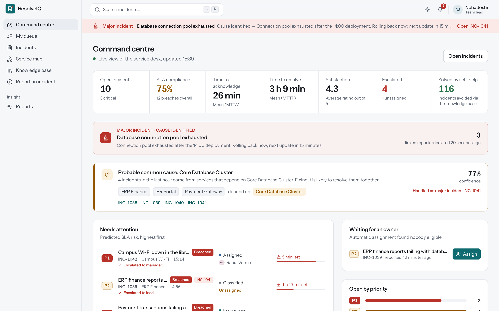

# ResolveIQ — Intelligent IT Service Management & Incident Resolution System

CS F213 / MAC F212 Object-Oriented Programming · Semester I, 2026-27 · Group project · **Group —**

| Member | ID |
|---|---|
| Moh Bhargava | 2024B4A70845H |
| Arnav Mhatre | 2025ADPS0135H |
| *Team member 3* | *ID number* |
| *Team member 4* | *ID number* |

ResolveIQ manages the complete lifecycle of IT incidents — **Report → Classify → Prioritise → Assign →
Investigate → Resolve → Verify → Close** — with automatic prioritisation, SLA monitoring, escalation,
notifications, a full audit trail and eight intelligent features. Around that core it adds what a real
service desk needs: a self-help knowledge base, major-incident coordination, file attachments, two-way
e-mail, bulk actions, and company sign-in with Google and two-step verification.

| | |
|---|---|
| **Backend** | Java 21 · Spring Boot 3.5 · Spring Security (JWT + rotating refresh cookies, OIDC, TOTP) · JPA/Hibernate · Flyway |
| **Database** | PostgreSQL 16 (production) · H2 (zero-setup development) |
| **Frontend** | React 19 + TypeScript + Vite + Tailwind CSS; light, dark and system themes |
| **Quality** | 145 automated tests (129 backend, 16 frontend), 82% backend line coverage, 0 accessibility violations (axe, WCAG 2.1 AA), GitHub Actions CI + CodeQL + Dependabot |
| **Security** | OWASP Top 10:2025 mapping with a test for each claim — see [SECURITY.md](docs/SECURITY.md) |
| **Deployment** | Docker image, Docker Compose, one-click Render Blueprint — see [DEPLOYMENT.md](docs/DEPLOYMENT.md) |
| **API docs** | Swagger UI at `http://localhost:8080/swagger-ui.html` (development) |

---

## Run it

**Prerequisite:** Java 21 (`java -version`). Nothing else — the Maven wrapper downloads Maven, the
development profile uses an embedded database, and the built web app is bundled inside the backend.

```sh
cd backend
./mvnw spring-boot:run          # first run downloads dependencies (~2 min)
```

Open **http://localhost:8080**, open **Try a demo account** on the sign-in page and pick a role.
The API documentation is at **http://localhost:8080/swagger-ui.html**.

### Working on the frontend (needs Node.js 20.19+ or 22)

```sh
cd frontend
npm install
npm run dev                     # http://localhost:5173, hot reload, proxies /api to the backend on :8080
npm run build:backend           # rebuild the bundled copy served by Spring Boot
```

```sh
./mvnw test                     # backend: 129 tests
npm test                        # frontend: 16 tests (in frontend/)
ITSM_RESET_DEMO=true ./mvnw spring-boot:run   # rebuild the live demo scenario (use before recording)
docker compose up --build       # production-like stack with PostgreSQL (from the repo root)
```

### Demo accounts — password `Password@123` for all

| Role | Login | What they see |
|---|---|---|
| Employee | `ava@resolveiq.test` | Own incidents; one awaiting her answer, one awaiting her verification |
| Employee | `priya@`, `rohan@`, `arjun@`, `sneha@` | Other reporters |
| Technician | `rahul@resolveiq.test` | An unacknowledged P1 (Wi-Fi) that is being escalated |
| Technician | `meera@`, `kabir@`, `isha@`, `dev@` | Different skills, workloads and seniority |
| Team Lead | `neha@resolveiq.test`, `vikram@` | Assignment, recommendations, reports |
| System Admin | `admin@resolveiq.test` | Users, services, categories, SLA policies, strategies, audit log |
| IT Manager | `manager@resolveiq.test` | Everything, top of the escalation chain |

---

## How the brief's requirements are met

| Requirement | Where |
|---|---|
| 3+ user roles | 5 roles via a class hierarchy: `Employee`, `Technician` → `TeamLead`, `Administrator` → `ItManager` |
| Incident create / view / update / assign / resolve / close | `IncidentController`, `IncidentService`, `Incident` |
| Priority from impact, urgency, criticality, users | `WeightedScoringPriorityStrategy`, `ItilMatrixPriorityStrategy` |
| ≥ 2 assignment strategies | **5**: Skill, Load, Round-robin, Experience, Smart |
| SLA calculation, tracking, violation detection, warnings | `SlaRecord`, `SlaPolicyResolver`, `SlaMonitorService` (background, every 30 s) |
| ≥ 2 notification mechanisms | **3**: In-app (live via SSE), E-mail (SMTP adapter or simulated), SMS (Twilio adapter or simulated) |
| Complete audit history | `AuditTrailObserver` → immutable `AuditRecord` (who, when, action, previous → new state) |
| ≥ 5 search criteria | **13**: text, number, status, priority, category, service, technician, reporter, SLA status, escalated, open-only, date from/to |
| ≥ 2 intelligent features | **8**: duplicate detection, correlation (with major-incident suggestion), auto-escalation, smart recommendation, SLA risk prediction, auto-categorisation (Naive Bayes ML), suggested resolutions, self-help deflection |
| ≥ 2 design patterns | **9**: Strategy, State, Observer, Factory, Adapter, Chain of Responsibility, Template Method, Repository, Builder |
| Persistence | PostgreSQL / H2 with Flyway-versioned schema |
| Security | BCrypt, 15-minute JWTs + rotating HttpOnly refresh cookies with theft detection, Google sign-in (OIDC + PKCE) limited to company domains, TOTP two-step verification, rate limiting, lockout, row-level access, strict CSP, safe uploads, audit of security events |
| New categories without code changes | Categories are data; the classifier learns new ones from their keywords instantly |
| Invalid state transitions prevented | State pattern — e.g. `NEW → CLOSED` throws `InvalidStateTransitionException` |

### Beyond the brief

| Feature | What it does |
|---|---|
| Knowledge base & self-help | Articles written from real fixes; while an employee types a report, matching articles appear and "This fixed it" avoids the ticket |
| Major incidents | Declare from a correlation cluster, link related reports, post stage updates to everyone affected, "I'm affected too", resolve all at once |
| Conversation & files | Chat-style thread per incident with internal notes; attachments checked by content and virus-scanned |
| Two-way e-mail | Notification e-mails carry `[INC-1042]`; replies become comments or answers, and new e-mails open incidents |
| Bulk actions | Assign, link, mark duplicate, resolve or close many incidents at once |
| Accounts | Google company sign-in, first-login profile, two-step verification with recovery codes, "where you're signed in", password reset |
| Administration | Role changes, CSV import of staff, unlock, sign out everywhere, allowed domains, security overview |

## Documentation

| Document | Contents |
|---|---|
| [REQUIREMENTS](docs/REQUIREMENTS.md) | Problem analysis, stakeholders, functional/non-functional requirements, business rules |
| [ARCHITECTURE](docs/ARCHITECTURE.md) | Architecture & UML diagrams (class, state, sequence, use case), OOP concepts, design patterns |
| [ALGORITHMS](docs/ALGORITHMS.md) | Priority, assignment, SLA, escalation and every intelligent feature, with formulas |
| [DATABASE](docs/DATABASE.md) | ER diagram, schema, relationships, sample data |
| [TECHNOLOGY](docs/TECHNOLOGY.md) | Technology selection report (the 9 questions), why Spring Boot is still Java, scaling, security |
| [TESTING](docs/TESTING.md) | Test strategy and documented test cases (functional, security, frontend, accessibility) |
| [SECURITY](docs/SECURITY.md) | Threat model, how sign-in works, OWASP Top 10:2025 mapping, known limitations |
| [DEPLOYMENT](docs/DEPLOYMENT.md) | Local, Docker Compose and Render; Google sign-in setup; every setting |
| [API](docs/API.md) | REST endpoint reference |
| [DESIGN](docs/DESIGN.md) | UI design system, themes, the three workspaces, screenshots |
| [TEAM GUIDE](docs/TEAM_GUIDE.md) | Module ownership, demo script, roadmap |

## Repository layout

```
backend/            Spring Boot API (Java 21)
  src/main/java/com/resolveiq/
    incident/       aggregate root, State pattern lifecycle, events, search, service
    priority/       priority Strategy pattern
    assignment/     assignment strategies (Strategy + Template Method)
    sla/            SLA policies, SLA clock, background monitor
    escalation/     Chain of Responsibility escalation
    intelligence/   NLP, TF-IDF similarity, Naive Bayes, correlation, risk prediction
    notification/   Observer → channels (Factory) → gateways (Adapter)
    audit/          append-only audit trail (Observer, Builder)
    security/       sessions, refresh tokens, 2FA, Google sign-in, rate limiting, crypto
    knowledge/      knowledge base and self-help
    attachment/     uploads, type detection, malware scanning
    user/ catalog/ settings/ report/ live/ web/ config/
  src/main/resources/db/migration/   Flyway SQL schema
  src/test/         unit and integration tests
frontend/           React + TypeScript web app
  src/pages/        one file per screen (employee, technician, command centre, admin…)
  src/components/   app shell, incident building blocks, dialogs, UI primitives
  src/lib/          API client, auth, theme, live updates, formatting
  src/**/*.test.*   Vitest + Testing Library tests
docs/               design documentation (Mermaid diagrams render on GitHub), screenshots
Dockerfile          builds frontend + backend into one image; render.yaml deploys it
.github/            CI, CodeQL, Dependabot
```


