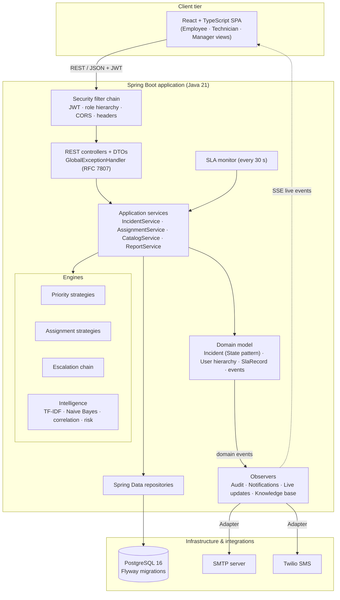
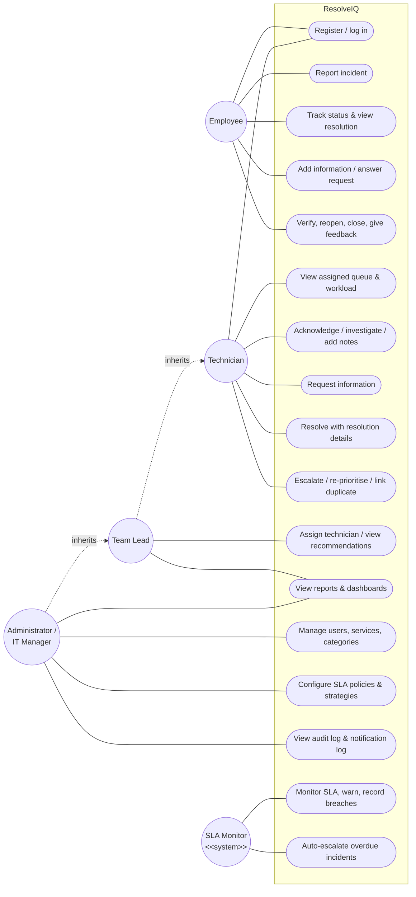
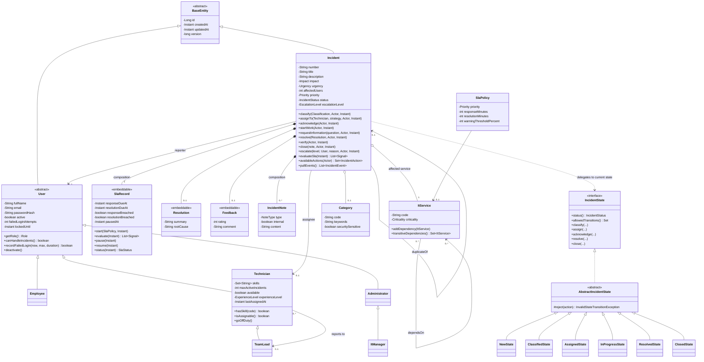
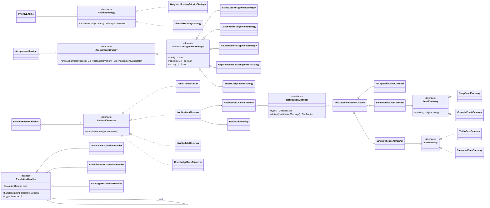
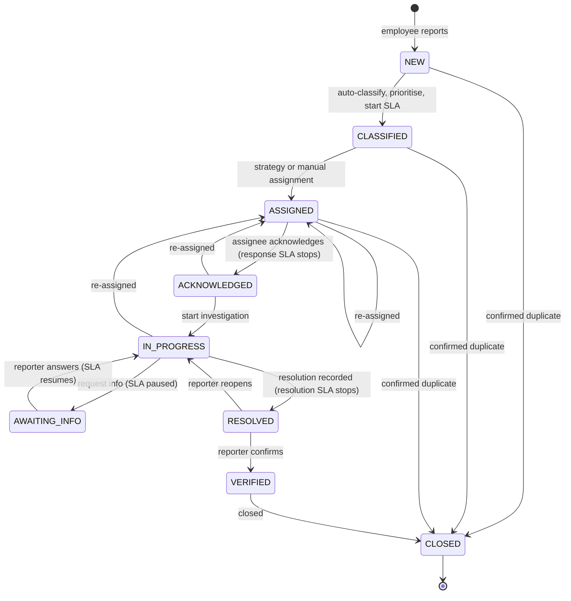
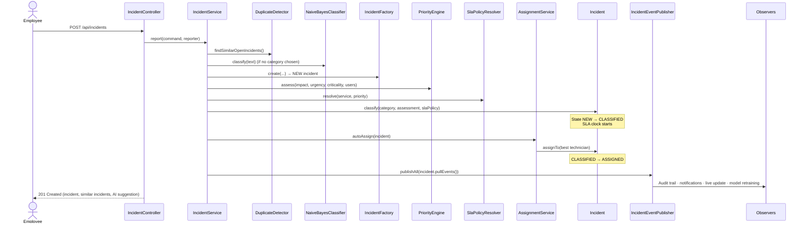

# Architecture & Object-Oriented Design

## 1. System architecture

ResolveIQ is a layered, stateless REST application. The browser (React) talks to a Spring Boot API over
HTTPS/JSON with a JWT; the API holds all business logic in a rich domain model; persistence is PostgreSQL.
Real-time updates are pushed with Server-Sent Events. A background scheduler runs the SLA monitor.

### Layer responsibilities

| Layer | Responsibility | Never does |
|---|---|---|
| Web (`web`) | HTTP mapping, validation of request shape, DTO mapping | Business rules |
| Application services | Use-case orchestration: load → call domain → save → publish events | Decide lifecycle rules |
| Domain (`incident.domain`, `user.domain`, `sla`, `catalog`) | Business rules, invariants, permissions, state transitions | Talk to HTTP or SQL |
| Engines (`priority`, `assignment`, `escalation`, `intelligence`) | Pluggable algorithms behind interfaces | Persist data |
| Observers (`audit`, `notification`, `live`) | React to domain events | Change incident state |
| Persistence (`*Repository`) | Data access via Spring Data JPA | Business logic |

Packages are organised **by business capability** (incident, sla, assignment…) rather than by technical
layer, so each capability can be understood, tested and changed on its own.

---

## 2. Use case diagram

---

## 3. Class diagram (domain core)

### Strategies, observers, factories and adapters

---

## 4. Incident lifecycle (State pattern)

Each state is a class (`IncidentStates.NewState`, `ClassifiedState`, …) extending `AbstractIncidentState`,
which rejects every operation by default ("deny by default"). A state overrides only what it allows, so an
illegal transition such as `NEW → CLOSED` is impossible by construction and raises
`InvalidStateTransitionException` (HTTP 409).

---

## 5. Workflow 1 — sequence of a new report

---

## 6. OOP concepts — where to find them

| Concept | Implementation |
|---|---|
| **Encapsulation** | `Incident`, `User`, `SlaRecord` have **no public setters**; state changes only through intention-revealing methods that enforce invariants (`assignTo`, `recordFailedLogin`, `pause`). Collections are exposed as unmodifiable views. The password hash never leaves the server. |
| **Abstraction** | `PriorityStrategy`, `AssignmentStrategy`, `NotificationChannel`, `EmailGateway`, `CategoryClassifier`, `IncidentState` describe *what*, hiding *how*. `IncidentService.report()` hides a 10-step workflow behind one call. |
| **Inheritance** (genuine *is-a*) | `TeamLead` **is a** `Technician`; `ItManager` **is an** `Administrator`; every user **is a** `User`. All entities extend `BaseEntity` (identity, timestamps, optimistic locking). Inheritance is *not* used where *has-a* fits (e.g. SLA is composed, not inherited). |
| **Polymorphism** | `user.getRole()`, `canHandleIncidents()` differ per subclass; any `PriorityStrategy` / `AssignmentStrategy` / `NotificationChannel` / `EscalationHandler` can be substituted at runtime. |
| **Interfaces** | 9 contracts: `IncidentState`, `PriorityStrategy`, `AssignmentStrategy`, `IncidentObserver`, `NotificationChannel`, `EmailGateway`, `SmsGateway`, `CategoryClassifier`, plus Spring Data repository interfaces. |
| **Composition** | `Incident` owns its `SlaRecord`, `Resolution`, `Feedback` (embedded) and `IncidentNote`s (cascade + orphan removal) — they cannot exist without it. |
| **Association / Aggregation** | `Incident → reporter`, `Incident → assignee` (association); `Incident → ItService/Category` (aggregation: shared, independent life cycle); `ItService ↔ ItService` dependency graph; `Technician → TeamLead`. |
| **Exception handling** | 17 custom exceptions under `ItsmException`, each with an `ErrorCode` → HTTP status; one `GlobalExceptionHandler` produces RFC 7807 JSON. Database outages → 503, concurrent edits → 409 (optimistic locking). |
| **Collections** | `EnumMap` (state registry, settings), `EnumSet` (allowed transitions, channels), `TreeSet` (sorted unique skills), `LinkedHashMap` (ordered reports), `CopyOnWriteArrayList` (thread-safe observer list), `ConcurrentHashMap` (live connections), `ArrayDeque` (BFS over the dependency graph), sparse `HashMap` vectors (TF-IDF). |
| **Generics** | `SimilarityEngine.rank<T>(...)`, `PageResponse<T>`, repositories. |
| **Modern Java** | Records for value objects and DTOs; a **sealed interface** for events with exhaustive pattern-matching `switch`; text blocks; `List.getFirst()` (Java 21). |

## 7. Design patterns (9)

| Pattern | Where | Why |
|---|---|---|
| **Strategy** | `PriorityStrategy` (2), `AssignmentStrategy` (5) | Algorithms are swapped at runtime from the admin settings without redeploying |
| **State** | `IncidentState` + 9 state classes | Lifecycle rules live in one class per state; illegal transitions impossible |
| **Observer** | `IncidentEventPublisher` + 4 `IncidentObserver`s | Audit, notifications, live dashboard and ML retraining react to events without the incident knowing them |
| **Factory** | `UserFactory`, `IncidentFactory`, `NotificationChannelFactory` | Centralises construction (right subclass, hashed password, unique number, enabled channels) |
| **Adapter** | `EmailGateway` ← `SmtpEmailGateway`/`ConsoleEmailGateway`; `SmsGateway` ← `TwilioSmsGateway`/`SimulatedSmsGateway` | Third-party APIs plug in behind our own interface; simulation and real delivery are interchangeable |
| **Chain of Responsibility** | `EscalationHandler` chain | Team Lead → System Admin → IT Manager; add a level by adding a handler |
| **Template Method** | `AbstractAssignmentStrategy.rank()`, `AbstractNotificationChannel.deliver()` | Fixed algorithm skeleton, subclasses supply only the varying step |
| **Repository** | Spring Data repositories | Domain asks for data by intent; persistence technology is replaceable |
| **Builder** | `AuditRecord.builder()` | Readable construction of records with many optional fields |

## 8. Extensibility checklist (what changes for common requirements)

| New requirement | Change needed |
|---|---|
| New incident category | Admin adds it in the UI — **no code** |
| New SLA tier for a service | Admin adds a policy — **no code** |
| New assignment algorithm | One class implementing `AssignmentStrategy` (auto-discovered) |
| New notification channel (Slack, WhatsApp) | One `NotificationChannel` class + enum value |
| New e-mail provider | One `EmailGateway` adapter |
| New escalation level | One `EscalationHandler`, linked into the chain |
| New reaction to incident activity (e.g. webhook) | One `IncidentObserver` |
| New lifecycle state (e.g. ON_HOLD) | One state class + registry entry |
