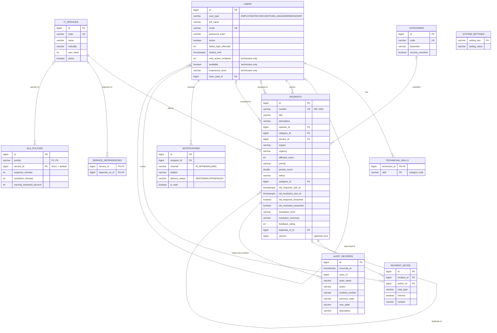

# Database Design

The schema is created by Flyway from `backend/src/main/resources/db/migration/V1__initial_schema.sql` and runs
unchanged on PostgreSQL 16 and H2 (PostgreSQL mode). Hibernate validates the mapping against it on start-up.

## ER diagram

## Design decisions

| Decision | Reason |
|---|---|
| **Single-table inheritance** for users | Most queries ("all active users", "who reported this?") span roles; technician columns are nullable |
| **SLA record embedded** in `incidents` (`sla_*` columns) | Composition: one-to-one, same life cycle, always read with the incident; no join |
| Resolution and feedback embedded | Same reasoning |
| `incident_number_seq` database sequence | Unique human-friendly numbers (`INC-1001`) even under concurrent creation |
| Audit records keep **name snapshots** and incident number, not FKs only | History must survive renames and deactivation; append-only, never updated |
| Categories and services are **rows, not enums** | Administrators add them at runtime without code changes |
| `service_dependencies` self many-to-many with a CHECK against self-loops | Dependency graph for correlation; cycles prevented in the domain |
| `version` column on every entity | Optimistic locking prevents lost updates |
| CHECK constraints (priority values, rating 1–5, targets > 0, affected users ≥ 1) | Database enforces invariants even if application code is bypassed |
| Indexes on status, priority, assignee, reporter, service, created_at, audit number/time | Back the 13 search filters and dashboards |
| `TIMESTAMP WITH TIME ZONE`, stored in UTC | Correct SLA arithmetic across zones |

## Sample data (seeded on first start)

| Table | Rows | Examples |
|---|---|---|
| users | 14 | 5 employees, 5 technicians, 2 team leads, 1 administrator, 1 IT manager |
| it_services | 13 | Core Network & DNS → Core Database → Identity & SSO → Payment Gateway / ERP / HR Portal / Email / Learning Portal… |
| categories | 9 | Hardware, Software, Network, Database, Cloud, Security (security-sensitive), Authentication, Application, Storage |
| sla_policies | 7 | 4 defaults (the brief's table) + Payment Gateway P1/P2 and Core Database P1 overrides |
| incidents | 47 | 36 resolved & closed over the past month (knowledge base) + 11 live incidents forming the demo scenario |
| audit_records | ~550 | Generated by the real domain methods |
