# User Interface Design

## Direction: a quiet console

An incident tool is used under pressure. The interface stays calm and neutral so the few things that
genuinely need attention — a P1, an SLA about to be breached, an escalation — are impossible to miss.
**Colour is reserved for meaning.** Everything else is greys, hairlines and type.

| | |
|---|---|
| Typeface | Instrument Sans (self-hosted, works offline), one family throughout; tabular figures for times, numbers and incident IDs |
| Accent | Deep teal `#0F6B6F` (dark mode `#4FB3AE`) for primary actions, links and the active SLA |
| Priority | P1 crimson (solid badge, the loudest element), P2 amber, P3 blue, P4 grey |
| Surfaces | Porcelain `#F6F7F9` / white (light); slate charcoal `#14171C` / `#1A1E24` (dark) |
| Charts | Teal and violet, validated for colour-blind separation and contrast in both themes |

### Signature element: the SLA fuse

Every incident carries a thin bar that burns down as its resolution window is used: teal while on
track, amber once at risk, red when breached, grey while paused waiting for the reporter, green when met.
The same element appears in lists, queues, dashboards and the incident page, so people learn to read it once.

## Themes

Light, dark, or match the operating system, chosen from the sun/moon menu in the top bar and remembered per
browser. All colours are CSS variables (design tokens) in `frontend/src/index.css`; dark mode redefines the
same tokens, so no component has theme-specific code. Re-skinning the product means editing that one block.

## Three workspaces

| Role | Lands on | Built around |
|---|---|---|
| Employee | Home | What needs *their* action (answer a question, confirm a fix), then their incidents |
| Technician | My queue | Their incidents ordered by deadline, with predicted SLA risk and capacity |
| Team lead, admin, manager | Command centre | KPIs, probable common causes, what's at risk, what has no owner, live activity |

## Interaction details

- **Report form with live assistance**: as the employee types, the AI category, the priority and deadlines
  the incident will get, and possible duplicates appear beside the form before submitting.
- **Only valid actions are shown**: the backend returns `availableActions` for the current user and state,
  so the incident page never offers a button the lifecycle would reject.
- **Explainability everywhere**: "Why P1?", the words that drove the AI category, the reasons behind each
  technician recommendation, the factors behind SLA risk.
- **Live updates**: notifications arrive as toasts and dashboards refresh through server-sent events.
- **⌘K / Ctrl K** opens a command palette to jump to any incident or page.
- Keyboard focus is always visible; motion is reduced when the OS asks for it; layouts work down to phone width.

## Screens

| | |
|---|---|
| 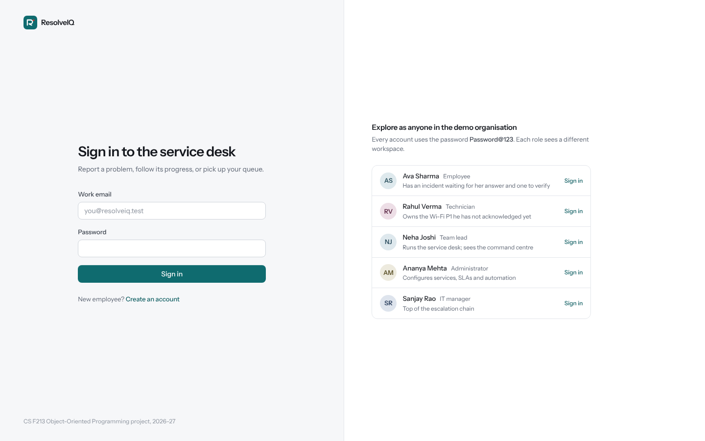 | 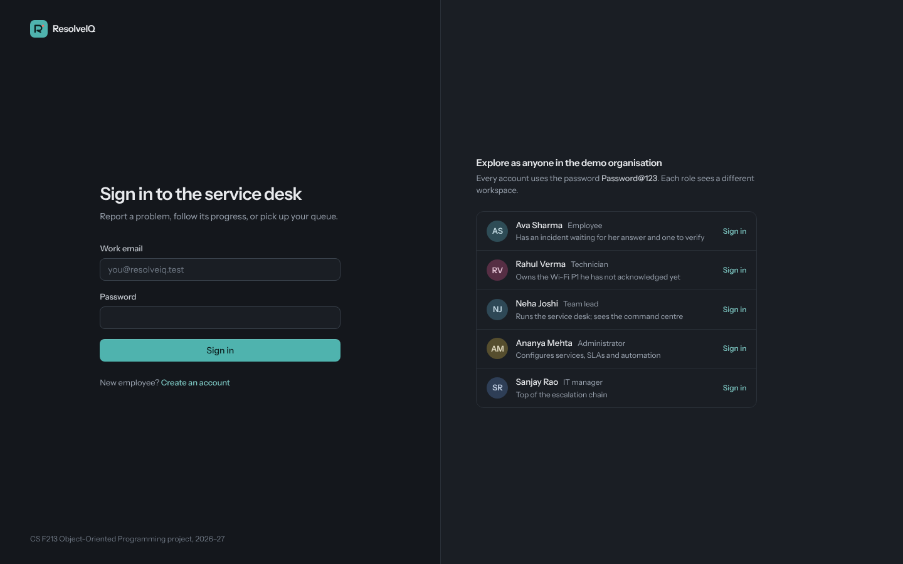 |
| 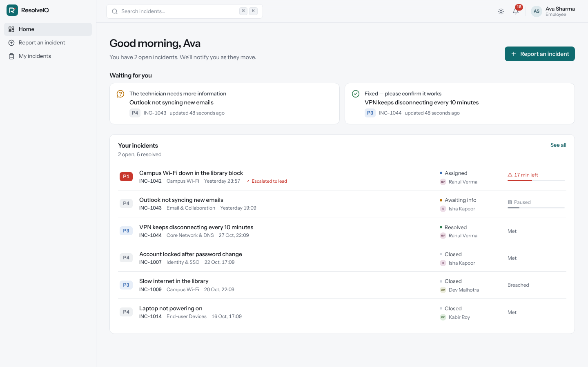 | 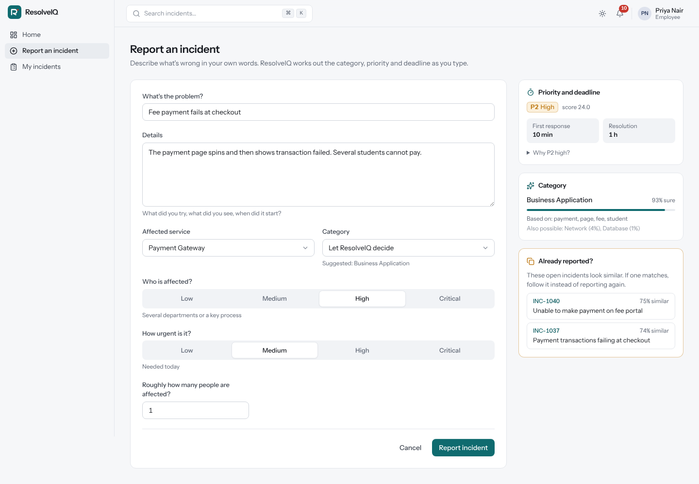 |
| 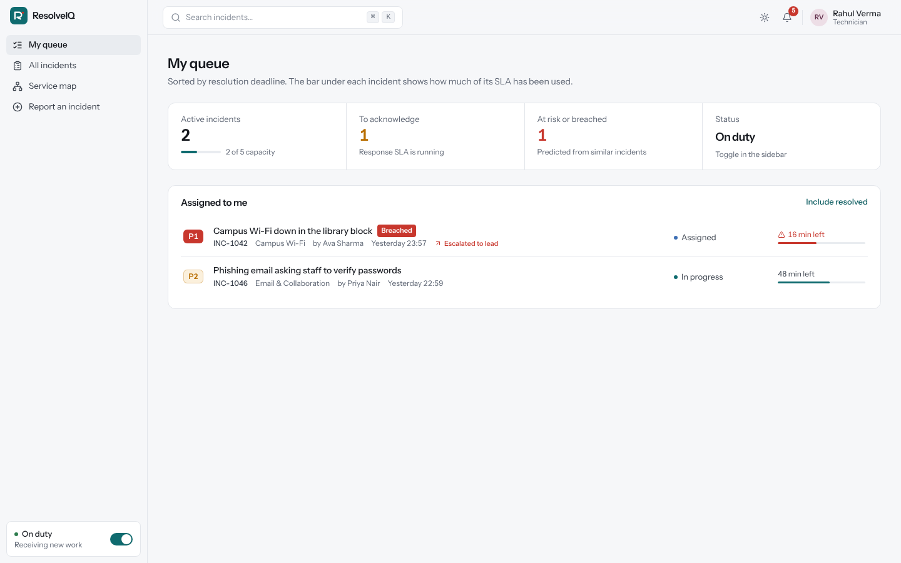 | 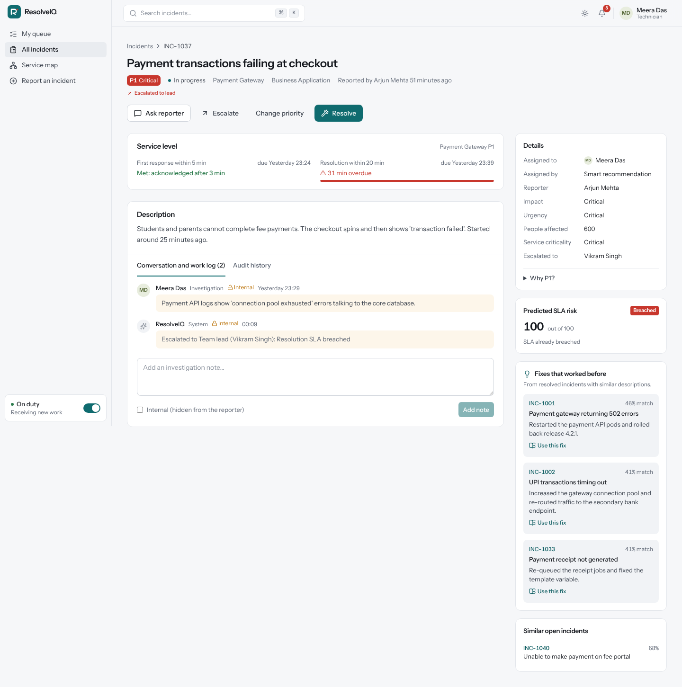 |
| 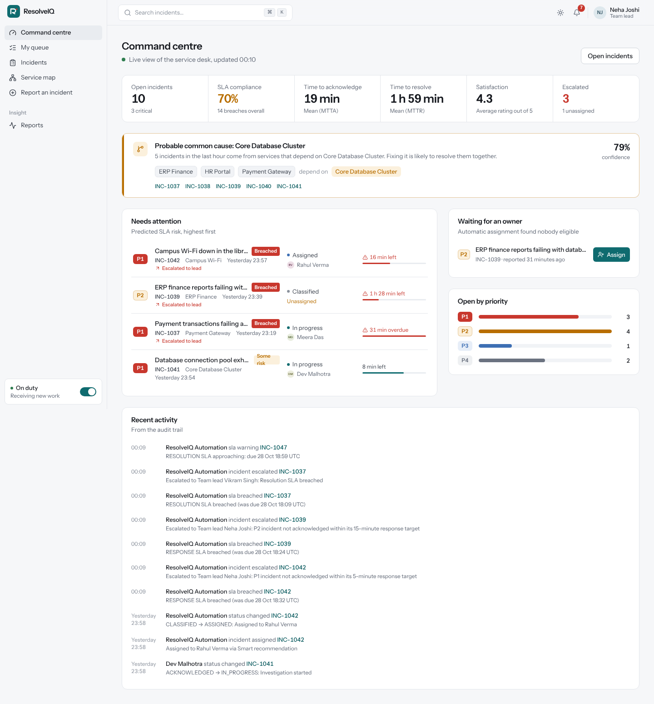 | 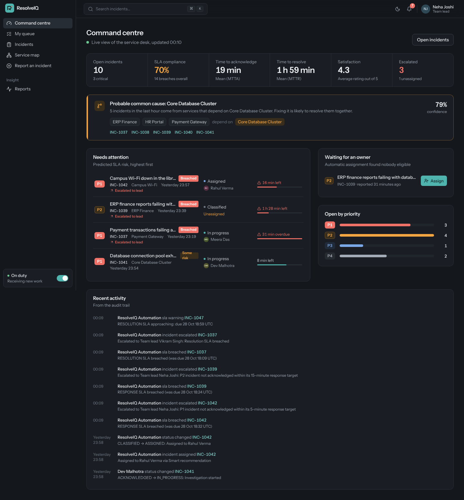 |
| 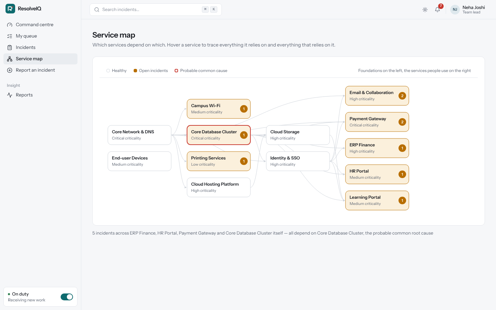 | 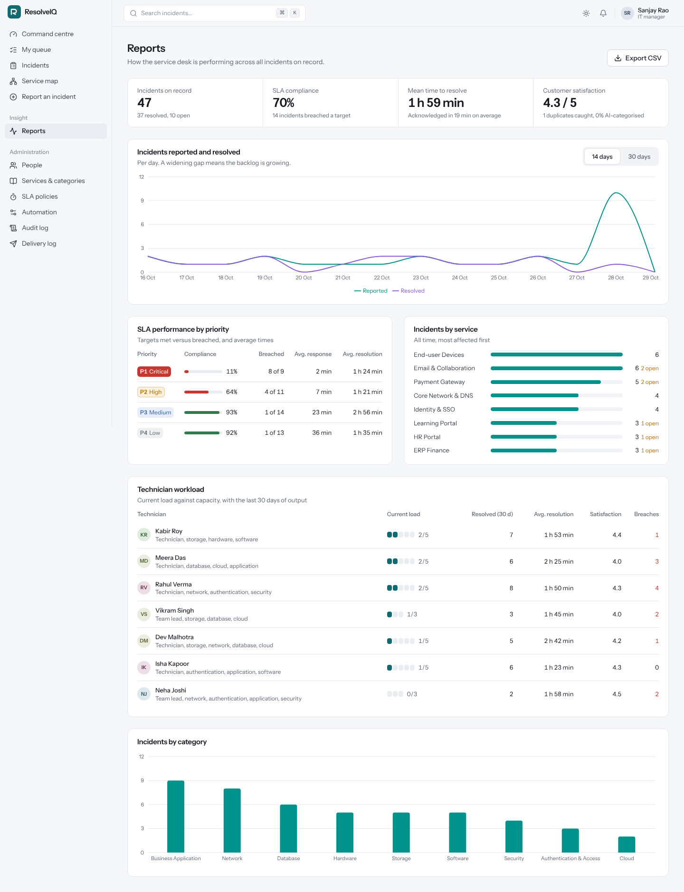 |
| 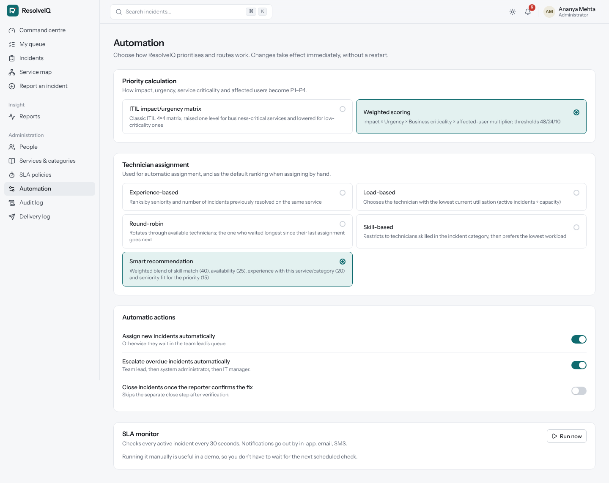 | 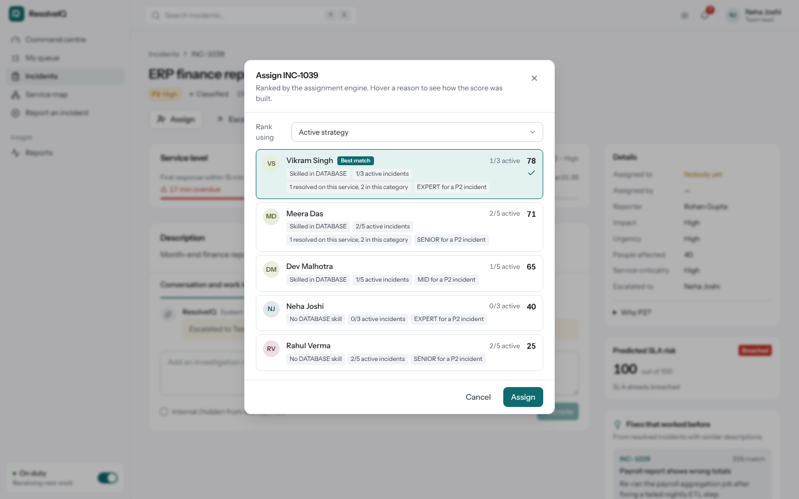 |
| 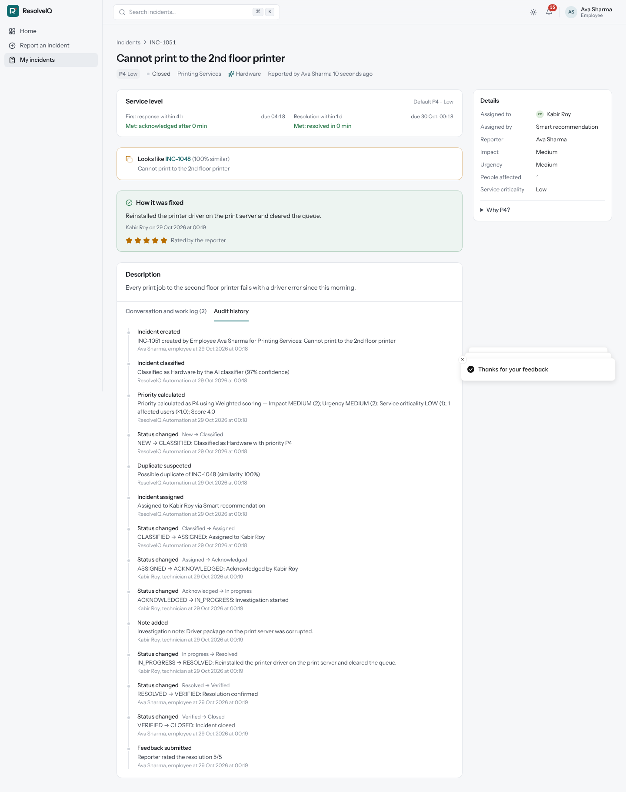 | 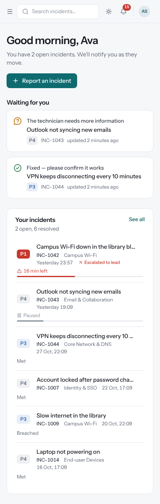 |
